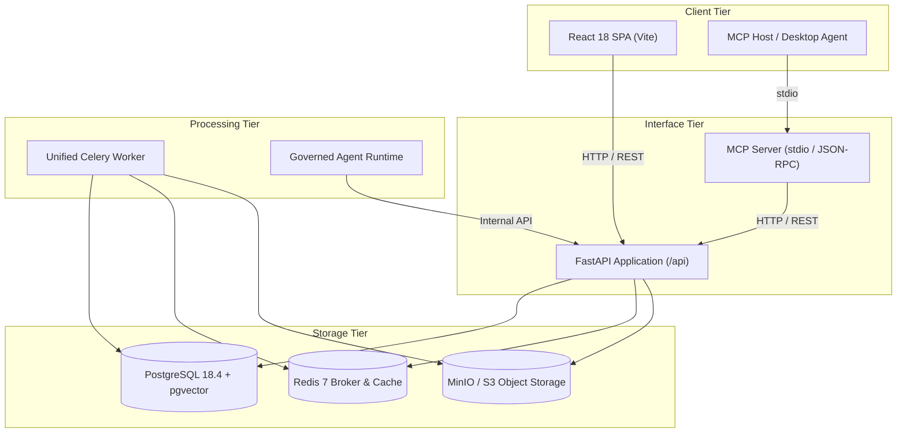

# Margin

Margin is an enterprise knowledge management system and a second brain for a corporate with AI-assisted "Ask your knowledge". It transforms multi-format architecture documentation, technical specifications, and organizational knowledge into verifiable atomic IdeaBlocks, canonical entity catalogs, explicit evidence-backed relationships, unified governance records, and citable AI answers.

PostgreSQL 18.4 with `pgvector` 0.8.5 serves as the authoritative system of record for canonical entities, IdeaBlocks, graph relationships, and embeddings, while S3-compatible object storage retains immutable source documents and converted artifacts. The React single-page application, FastAPI HTTP service, Celery background worker, Model Context Protocol (MCP) server, and autonomous agent runtime all operate through a unified, strictly governed, and role-authorized API surface.

## Table of contents

- [Capabilities](#capabilities)
  - [Sources and ingestion](#sources-and-ingestion)
  - [Atomic knowledge units (IdeaBlocks)](#atomic-knowledge-units-ideablocks)
  - [Entities and controlled vocabulary](#entities-and-controlled-vocabulary)
  - [Relationships and knowledge graph](#relationships-and-knowledge-graph)
  - [Unified architecture governance and review](#unified-architecture-governance-and-review)
  - [Retrieval and conversational "Ask Margin"](#retrieval-and-conversational-ask-margin)
  - [On-demand reading surfaces and Architecture Wiki](#on-demand-reading-surfaces-and-architecture-wiki)
  - [Personal layer ("Your Space")](#personal-layer-your-space)
  - [Autonomous agent runtime and playbooks](#autonomous-agent-runtime-and-playbooks)
  - [Model Context Protocol (MCP) integration](#model-context-protocol-mcp-integration)
  - [Deterministic export bundles](#deterministic-export-bundles)
  - [Enterprise administration, security, and quality](#enterprise-administration-security-and-quality)
- [Architecture](#architecture)
  - [Runtime topology](#runtime-topology)
  - [Repository layout](#repository-layout)
  - [HTTP API specification](#http-api-specification)
  - [Web application](#web-application)
  - [Background processing and Celery queues](#background-processing-and-celery-queues)
  - [Authorization and security model](#authorization-and-security-model)
  - [Database schema, vectors, and migrations](#database-schema-vectors-and-migrations)
- [Getting started](#getting-started)
  - [Prerequisites](#prerequisites)
  - [Local development installation](#local-development-installation)
  - [Running the stack with Docker Compose](#running-the-stack-with-docker-compose)
  - [Database bootstrap and seeding](#database-bootstrap-and-seeding)
  - [Running the Model Context Protocol (MCP) server](#running-the-model-context-protocol-mcp-server)
  - [Health and readiness verification](#health-and-readiness-verification)
- [Quality and verification commands](#quality-and-verification-commands)
- [Design principles and explicit boundaries](#design-principles-and-explicit-boundaries)
- [Documentation index](#documentation-index)

## Capabilities

### Sources and ingestion

- **Multi-format document conversion**: Convert rich documents locally. PDF, DOCX, and PPTX are converted via a primary Docling converter with a secondary MarkItDown converter fallback. Raster images (PNG, JPEG, TIFF, WebP) are processed through dedicated image converters with visual-asset and OCR extraction.
- **Dependency-free text and diagram parsing**: Parse Markdown, YAML, JSON, and plain text, as well as diagram source formats: Mermaid (`.mmd`, `.mermaid`), PlantUML (`.puml`, `.plantuml`, `.iuml`), and Structurizr DSL (`.dsl`).
- **Machine-readable API contracts**: Ingest OpenAPI (v2, v3, v3.1) and AsyncAPI (v2, v3) specifications, mapping endpoints, operations, message channels, data schemas, events, and security schemes into canonical entities.
- **Batch ingestion with directory hierarchy**: Upload single files or batches of up to 50 files simultaneously via the Knowledge Upload wizard, preserving relative folder hierarchies and contextual metadata.
- **Ingestion lifecycle observability**: Comprehensive tracking for every source: file versions, converted pages, normalized elements, per-stage status, ingestion receipts, extraction reports, unresolved elements, reprocessing diffs, retry, and cancellation.
- **Source element provenance**: Interactive document preview and drill-down from any extracted claim directly to the exact bounding box, page number, and quoted passage of origin.

### Atomic knowledge units (IdeaBlocks)

- **Atomic verifiable claims**: IdeaBlocks are the fundamental units of architecture knowledge. Each block encapsulates one discrete, falsifiable architectural statement with a deterministic SHA-256 identifier (`ib_...`).
- **Immutable revision history**: Modifications create new immutable revisions rather than in-place overwrites, preserving an auditable history of revisions and rationale.
- **Strict knowledge lifecycle states**: Explicit governance states for every claim: `candidate`, `verified`, `duplicate`, `stale`, `rejected`, or `superseded`.
- **Grounded evidence mapping**: Every claim revision references verified source elements, retaining exact quotation text, confidence scoring, and extractor provenance.
- **Manual curation and governance**: Create manual IdeaBlocks, author revision edits, and route claims through approval, rejection, or reconsideration workflows.
- **Ontology version tagging**: Every IdeaBlock revision is pinned to the active ontology schema version that governed its extraction and validation.

### Entities and controlled vocabulary

- **Canonical entity catalog**: Governed catalog of architectural entities (Domains, Systems, Containers, Components, APIs, Databases, Services, Teams, Roles) with typed attributes, ownership, and lifecycle status.
- **Controlled aliases and synonyms**: Track historical names, abbreviations, and acronyms with explicit alias deprecation and merge support.
- **Unresolved mention queue**: Surface ambiguous or unrecognized entity mentions from ingested text into a dedicated review queue for human binding to existing or newly created entities.
- **Entity lifecycle management**: Transition entities across states: approve draft candidates, update attributes with mandatory audit reasons, add or deprecate aliases, merge duplicate entities (with reference redirection), supersede with successors, or retire obsolete entities.
- **Automatic re-resolution**: Background worker queue automatically cascades alias updates and entity merges across related historical claims and relationships.

### Relationships and knowledge graph

- **Evidence-backed relationship records**: Typed relationships connecting entities and IdeaBlocks (e.g., `depends_on`, `calls`, `implements`, `stores`, `deploys_to`, `owns`, `validates`) backed by confidence scores, review states, temporal validity windows (`valid_from`, `valid_to`), and source element provenance.
- **Bounded relationship traversal**: High-performance SQL queries for direct neighbors, bounded shortest paths between entities, architectural blast radius / impact analysis, governed-entity links, and linked IdeaBlocks.
- **On-demand graph analytics**: Compute authorized subgraphs dynamically without persistent graph projection engines. Analyze Louvain community clusters, detect unexpected architectural cross-connections, identify knowledge gaps, and evaluate graph hygiene (dangling edges, circular dependencies, orphan nodes).
- **Reader attention controls**: Dismiss or defer surfaced graph insights permanently or until a specified expiration date, recording reader decisions without altering underlying canonical facts.

### Unified architecture governance and review

- **Five core governance record types**: Unified management for Architecture Decision Records (ADRs), Architecture Risks, Architectural Waivers, Technical Debt, and Architecture Backlog items.
- **Governed lifecycle transitions**: Dedicated state machines for each record type, including waiver renewals and revocations, risk acceptances and closures, technical debt resolutions, backlog completions, and supersessions.
- **Bi-directional relationship linking**: Link governance records directly to IdeaBlocks and canonical entities, establish relations between governance records, and generate Architecture Backlog items directly from findings.
- **Human-in-the-loop review queue**: Assembled evidence bundles for quarantined, conflicting, or candidate extraction and governance items. Assign tasks, review evidence, record structured semantic decisions, and approve or reject actions.
- **Knowledge hygiene and contradiction analysis**: Automated detection of conflicting architectural claims, blind-spot identification across unmonitored systems, and governance lint reports that proactively generate review tasks.

### Retrieval and conversational "Ask Margin"

- **Hybrid lexical and dense search**: Fuses BM25 full-text PostgreSQL queries with pgvector dense vector embeddings using Reciprocal Rank Fusion (RRF), followed by citation hydration.
- **Cross-encoder reranking**: Optional precision reranking with cross-encoder models (`BAAI/bge-reranker-base`) over top candidate sets.
- **Personalized ranking boost**: Bounded, transparent tie-breaking based on user domain affinity and reading history that never elevates unauthorized records.
- **Cited question answering ("Ask Margin")**: Synthesizes verified answers strictly grounded in authorized evidence with inline citations (`[^1]`). Answers cleanly fall back to search-only results if verifiable citations cannot be assembled.
- **Multi-turn conversation threads**: Threaded conversational sessions (`/ask/:threadId`) that retain prior conversational context while re-verifying access permissions on every turn.
- **Granular governance filters**: Scope search queries by domain, category, sensitivity, verification status, entity types/terms, relationship types, IdeaBlock types, source documents, governance record types, backlog states, and temporal dates.
- **Bounded authorization expansion**: Expand search candidates across linked relationships while enforcing authorization filters at each traversal hop.
- **Context budgeting and safety**: Strict character and token budget allocations across index context, record evidence, and answer reserves. Queries are inspected for prompt injection and input sanitization.
- **Global search command palette**: Universal search palette (`Ctrl+K` / `Cmd+K`) indexing IdeaBlocks, canonical entities, governance records, and source elements.

### On-demand reading surfaces and Architecture Wiki

- **Dynamic Architecture Wiki**: Composes an on-demand, unified architecture wiki directly from canonical database records (domains, entities, IdeaBlocks, governance, diagrams, and C4 trees) with zero compiled static files or Git mirrors.
- **Domain narratives**: Automatically generated narratives synthesizing verified architectural claims and explicitly separating candidate or unverified findings.
- **Domain charters**: Versioned charters authored by domain stewards establishing scope, purpose, boundaries, and terminology to guide automated extraction without biasing retrieval ranking.
- **Architecture Health heatmap**: Domain-level heatmap visualizing overall health scores, stale claims, unowned entities, high-severity risks, unresolved technical debt, expired waivers, missing ADR coverage, and disaster recovery gaps.
- **C4 Explorer**: Interactive drill-down navigation through C4 model hierarchies (Domain -> System -> Container -> Component) linked to evidence citations and governance records.
- **Governed diagram registry**: Unified catalog of architecture diagrams rendered directly in the browser (client-side Mermaid rendering, SVG rendering for PlantUML and Structurizr).

### Personal layer ("Your Space")

- **Private workspace (`/me`)**: User-scoped personal space containing private notes, bookmarked canonical records, saved filtered views, and conversation threads.
- **Non-polluting design**: Personal notes and views reference canonical records without duplicating them, remain strictly private, and cannot become published claims without going through ingestion and governance.
- **Personal feed and reading queue**: Dynamic activity stream highlighting recently viewed records, domain affinities, and unread verified claims relevant to the user's role.
- **Auditable ranking influence**: The influence of personal boosts on retrieval order is transparently exposed in search result payloads.

### Autonomous agent runtime and playbooks

- **Bounded agent executions**: Launch autonomous agent runs constrained by strict iteration budgets, token allowances, and timeout limits with immediate cancellation support.
- **Auditable event stream**: Every agent step, tool call, reasoning turn, and intermediate output is persisted to an immutable event log.
- **Non-destructive proposal workflow**: The agent cannot directly modify the knowledge base. Proposed changes are generated as structured diffs (`AgentProposal`) requiring human approval. Approved canonical changes route to the review queue rather than writing directly to production.
- **Human-in-the-loop interaction**: Mid-execution structured clarification prompts (`request_human_input`) allowing agents to pause and request guidance from human operators.
- **Domain playbooks**: Standardized agent playbooks discovered dynamically across operator-configured paths, the repository `playbooks/` folder, and `~/.margin/playbooks/`.
- **Read-only toolset**: Default read-only tools: `knowledge_search`, `knowledge_entity`, `knowledge_neighbors`, `knowledge_evidence`, and `domain_narrative`. Write-capable tools require explicit server grants.

### Model Context Protocol (MCP) integration

- **First-class MCP server**: Standalone MCP server implementation (`apps/mcp`) running over standard I/O (JSON-RPC), communicating with the Margin API over authorized HTTP endpoints.
- **Inherited enterprise authorization**: Reuses the central RBAC security model using bearer tokens or configured service principals, ensuring third-party AI assistants inherit exact user permissions and audit tracking.
- **Exposed MCP tools**:
  - `margin_search`: Governed hybrid search returning verified claims and citations.
  - `margin_ask`: Cited question answering grounded in authorized evidence.
  - `margin_get_entity`: Read canonical entity metadata, aliases, and attributes.
  - `margin_get_neighborhood`: Traverse entity relationships within an authorized boundary.
  - `margin_get_evidence`: Retrieve exact source elements and quoted provenance.
  - `margin_get_graph`: Retrieve community clusters, insights, and graph health.
  - `margin_raise_review`: Programmatically submit review tasks for human evaluation.
- **Exposed MCP resources**:
  - `margin://domains`: Catalog of all readable architecture domains.
  - `margin://domain/{domain_id}`: Domain details and charter.
  - `margin://domain/{domain_id}/briefing`: Composed domain briefing.
  - `margin://entity/{entity_id}`: Canonical entity specification.
  - `margin://evidence/{idea_block_id}`: Evidence chain for an IdeaBlock.

### Deterministic export bundles

- **Scope-aware domain exports**: Asynchronous generation of portable domain archive packages triggered from Your Space and built by background workers.
- **Permission filtering**: Export contents are bounded by the requester's RBAC scope at request time, preventing leakage of unpermitted claims, entities, or relationships.
- **Deterministic byte reproducible archives**: Same input records produce byte-identical archives with matching cryptographic SHA-256 hashes.
- **Strictly scoped manifest**: Explicit inclusion of canonical records and source elements, with structural exclusion of secrets, model configurations, embeddings, runtime state, personal data, and internal audit logs.
- **Private ownership**: Export archives are private to the requesting principal and protected against unauthorized retrieval.

### Enterprise administration, security, and quality

- **Model catalog administration**: Centralized management of LLM, embedding, and reranking models. Configure capabilities, context lengths, licensing profiles, hardware requirements, and secret references with live health probe testing.
- **Role-based user access management**: Configure access profiles binding users to groups, permitted domains, category scopes, and sensitivity thresholds (`internal`, `confidential`, `restricted`), with dry-run permission checks (`POST /api/admin/access/check`).
- **Comprehensive system health**: Real-time observability for API processes, PostgreSQL connection pooling, Redis queues, MinIO storage buckets, and document conversion dependencies.
- **Evaluation harness and release gates**: Automated regression testing against canonical gold corpuses, surface quality benchmarks, red-team prompt injection tests, and release gating tools (`margin-evaluate`).
- **Supply chain and compliance**: CycloneDX Software Bill of Materials (SBOM) generation and automated vulnerability scanning using Syft and Grype.

## Architecture

### Runtime topology

Margin is designed as a governed, modular monolith consisting of:

- **Web client**: React 18 single-page application built with Vite and TypeScript.
- **API service**: FastAPI application providing authenticated REST endpoints, RBAC enforcement, and audit logging.
- **Background worker**: Celery worker consuming background queues for conversion, extraction, embedding, review, export, and maintenance.
- **Model Context Protocol (MCP) server**: Independent process connecting desktop and IDE AI agents to the Margin API over stdio.
- **Canonical database**: PostgreSQL 18.4 with `pgvector` 0.8.5 for relational records, graph structures, full-text search indexes, and vector embeddings.
- **Object storage**: S3-compatible storage (MinIO for local development) storing immutable original files and converted document previews.
- **Task broker & cache**: Redis 7 for Celery message queuing, asynchronous task state, and short-lived caching.
- **Identity provider (optional)**: Keycloak 26 providing OpenID Connect (OIDC) authentication via the `auth` Compose profile.



### Repository layout

| Path                         | Purpose and Contents                                                                                           |
| ---------------------------- | -------------------------------------------------------------------------------------------------------------- |
| `apps/api/`                  | FastAPI application: HTTP routers, Pydantic schemas, RBAC middleware, and `margin-admin` CLI                   |
| `apps/web/`                  | React 18 single-page application: UI views, shared components, styling, and Playwright end-to-end tests        |
| `apps/mcp/`                  | Model Context Protocol server package (`margin_mcp`): stdio transport, tools, resources, and tests             |
| `packages/margin_agent/`     | Autonomous agent runtime, playbook loaders, execution sandboxing, tool handlers, and proposal diff engine      |
| `packages/margin_auth/`      | RBAC permission evaluation, token validation, principal models, and security scopes                            |
| `packages/margin_db/`        | SQLAlchemy 2.0 models, Alembic migrations (23 revisions), database sessions, seed scripts, and queries         |
| `packages/margin_embedding/` | Embedding provider abstraction (Sentence Transformers, OpenAI-compatible), batching, and cache factory         |
| `packages/margin_eval/`      | Benchmark harnesses, gold-corpus evaluation, surface quality gates, and `margin-evaluate` CLI                  |
| `packages/margin_graph/`     | In-memory graph analytics: Louvain community detection, graph hygiene checks, and architectural insights       |
| `packages/margin_inference/` | Governed LLM client abstraction, model registry integration, provider secrets, and error handling              |
| `packages/margin_ingest/`    | Document converters (Docling, MarkItDown, Pillow, Mermaid, PlantUML, Structurizr), OpenAPI/AsyncAPI parsers    |
| `packages/margin_retrieval/` | Hybrid search engine, Reciprocal Rank Fusion (RRF), cross-encoder reranking, and citation hydration            |
| `packages/margin_schema/`    | Pydantic data contracts, canonical ontology registry, entity kinds, relationship types, and identifiers        |
| `workers/`                   | Unified Celery worker application: tasks for ingestion, extraction, embedding, review, export, and maintenance |
| `infra/`                     | Docker Compose stack, PostgreSQL initialization, Keycloak realm definitions, and MinIO bootstrap               |
| `scripts/`                   | Runtime security guards (`check_runtime_guards.py`), performance load suites, and disaster recovery validation |
| `tests/`                     | Comprehensive test suite: integration tests, gold corpus fixtures, and cross-package test suites               |
| `docs/`                      | System architecture documentation, metamodel, target contracts, ADRs, runbooks, and compliance policies        |

### HTTP API specification

All API endpoints are mounted under `/api`, with core health checks exposed at the root:

- **System & Session**:
  - `GET /health` — Simple service liveness check.
  - `GET /ready` — Readiness check validating database connectivity and converter dependencies.
  - `GET /rbac/me`, `GET /api/rbac/me` — Authenticated user identity, assigned groups, and effective permissions.
- **Sources & Documents**:
  - `POST /api/sources` — Upload a single architecture document.
  - `POST /api/sources/batch` — Batch upload up to 50 documents preserving folder hierarchies.
  - `GET /api/sources` — List readable source documents with metadata and processing status.
  - `GET /api/sources/{id}` — Get detailed metadata and status for a source document.
  - `PATCH /api/sources/{id}` — Update source document metadata.
  - `DELETE /api/sources/{id}` — Remove a source document and its associated extracted elements.
  - `GET /api/sources/{id}/pages` — List converted pages for a source document.
  - `GET /api/sources/{id}/elements` — Converted source elements with bounding locations.
  - `GET /api/sources/{id}/preview` — Formatted document preview (Markdown or HTML).
  - `GET /api/sources/{id}/file` — Download original source file from object storage.
  - `GET /api/sources/{id}/preview-file` — Converted preview artifact.
  - `GET /api/sources/{id}/versions` — Revision history for a source document.
  - `POST /api/sources/{id}/reprocess` — Trigger source reprocessing and generate diffs.
  - `PATCH /api/admin/sources/{id}/metadata` — Administrative metadata update.
  - `POST /api/admin/sources/{id}/retry` — Administrative pipeline retry.
- **Ingestion Jobs**:
  - `GET /api/jobs`, `GET /api/admin/ingestion-jobs` — List ingestion jobs.
  - `GET /api/jobs/{id}`, `GET /api/admin/ingestion-jobs/{id}` — Ingestion job status and stage progress.
  - `POST /api/jobs/{id}/retry`, `POST /api/admin/ingestion-jobs/{id}/retry` — Retry failed job.
  - `POST /api/jobs/{id}/cancel`, `POST /api/admin/ingestion-jobs/{id}/cancel` — Cancel active job.
- **Extraction & Provenance**:
  - `POST /api/sources/{id}/extract` — Execute extraction pipeline on a source document.
  - `POST /api/sources/{id}/extractions` — Trigger configured extraction runs.
  - `GET /api/sources/{id}/ingestion-receipt` — Ingestion receipt summarizing elements, entities, and blocks.
  - `GET /api/sources/{id}/reprocessing-diffs` — Diff report comparing extractions across versions.
  - `GET /api/sources/{id}/extraction-report` — Extraction execution and quality report.
- **Knowledge & IdeaBlocks**:
  - `GET /api/ideablocks` — Query, filter, and search authorized IdeaBlocks.
  - `POST /api/ideablocks` — Create manual candidate IdeaBlock.
  - `GET /api/ideablocks/{id}` — Retrieve IdeaBlock with full revision history and evidence quotes.
  - `PATCH /api/ideablocks/{id}` — Update IdeaBlock statement (creates a new immutable revision).
  - `PATCH /api/ideablocks/{id}/status` — Transition IdeaBlock lifecycle status.
  - `DELETE /api/ideablocks/{id}` — Retire an IdeaBlock.
  - `GET /api/sources/{id}/ideablocks` — List IdeaBlocks extracted from a specific document.
  - `GET /api/evidence/{evidence_id}` — Retrieve exact quoted passage and provenance for an evidence record.
  - `GET /api/audit-events` — Audit history of knowledge base modifications.
- **Canonical Entities & Vocabulary**:
  - `GET /api/entities` — List canonical entities filtered by kind, domain, or status.
  - `POST /api/entities` — Create a new canonical entity.
  - `GET /api/entities/{id}` — Retrieve entity details, aliases, lifecycle status, and ownership.
  - `PATCH /api/entities/{id}` — Update entity attributes with a recorded reason.
  - `POST /api/entities/{id}/approve` — Approve a draft entity into the canonical catalog.
  - `POST /api/entities/{id}/aliases` — Add an alias or acronym to an entity.
  - `POST /api/entities/{id}/aliases/{alias_id}/deprecate` — Deprecate an alias.
  - `POST /api/entities/{id}/merge` — Merge entity into a target entity, redirecting relationships.
  - `POST /api/entities/{id}/supersede` — Supersede entity with a successor entity.
  - `POST /api/entities/{id}/retire` — Retire an entity.
  - `GET /api/entities/catalog/ontology` — Retrieve governing ontology kinds and constraints.
  - `GET /api/entities/mentions` — List unresolved text mentions awaiting review.
  - `POST /api/entities/mentions/{mention_id}/resolve` — Bind mention to a canonical entity.
- **Relationships**:
  - `GET /api/relationships/neighbors/{entity_id}` — Bounded neighbor graph around an entity.
  - `POST /api/relationships/path` — Find shortest bounded relationship path between two entities.
  - `GET /api/relationships/impact/{entity_id}` — Impact and blast radius analysis.
  - `GET /api/relationships/governed-entity/{entity_id}` — Governance records linked to an entity.
  - `GET /api/relationships/related-idea-block/{idea_block_id}` — Entities and IdeaBlocks related to a block.
  - `POST /api/sources/relationships/{relationship_id}/approve` — Approve candidate relationship.
  - `POST /api/sources/relationships/{relationship_id}/reject` — Reject candidate relationship.
- **Knowledge Graph**:
  - `GET /api/graph/subgraph` — Query authorized subgraph for exploration.
  - `GET /api/graph/communities` — On-demand Louvain community clusters.
  - `GET /api/graph/insights` — Surprising connections and knowledge gaps.
  - `GET /api/graph/hygiene` — Graph hygiene metrics (dangling edges, circularity, orphans).
  - `POST /api/graph/insights/decisions` — Record reader dismissal or deferral decisions.
- **Unified Architecture Governance**:
  - `GET /api/governance/records` — Query governance records (ADRs, risks, waivers, tech debt, backlog).
  - `POST /api/governance/records` — Create a new governance record.
  - `GET /api/governance/records/{id}` — Retrieve detailed governance record with audit trails.
  - `PATCH /api/governance/records/{id}` — Update mutable fields on a governance record.
  - `POST /api/governance/records/{id}/transitions` — Transition record status.
  - `POST /api/governance/records/{id}/relations` — Link governance records together.
  - `POST /api/governance/records/{id}/idea-blocks` — Link IdeaBlock to governance record.
  - `DELETE /api/governance/records/{id}/idea-blocks/{idea_block_id}` — Unlink IdeaBlock.
  - `POST /api/governance/records/{id}/entities` — Link Entity to governance record.
  - `DELETE /api/governance/records/{id}/entities/{entity_id}` — Unlink Entity.
  - `POST /api/governance/records/{id}/architecture-backlog` — Create backlog item from origin record.
  - `POST /api/governance/records/{id}/waiver-renewals` — Renew waiver with updated validity.
  - `POST /api/governance/records/{id}/waiver-revocations` — Revoke active waiver.
  - `POST /api/governance/records/{id}/risk-acceptances` — Record formal risk acceptance.
  - `POST /api/governance/records/{id}/risk-closures` — Close risk.
  - `POST /api/governance/records/{id}/technical-debt-resolutions` — Mark technical debt as resolved.
  - `POST /api/governance/records/{id}/architecture-backlog-completions` — Complete backlog item.
  - `POST /api/governance/records/{id}/supersede` — Supersede governance record with a successor.
  - `GET /api/governance/health/lint-report` — Governance consistency and coverage lint report.
  - `POST /api/governance/contradictions/detect` — Scan for conflicting statements across claims.
  - `POST /api/governance/blind-spots/detect` — Scan for unmonitored architecture blind spots.
- **Governance Review Queue**:
  - `POST /api/governance/review/tasks` — Create a review task.
  - `GET /api/governance/review/tasks` — List pending review tasks.
  - `GET /api/governance/review/tasks/{id}` — Get review task details.
  - `GET /api/governance/review/tasks/{id}/bundle` — Retrieve assembled evidence bundle for review.
  - `POST /api/governance/review/tasks/{id}/decision` — Record semantic review decision.
  - `POST /api/governance/review/tasks/{id}/action` — Approve or reject review bundle action.
  - `PATCH /api/governance/review/tasks/{id}` — Update task assignment or metadata.
- **Retrieval & "Ask Margin"**:
  - `POST /api/search` — Execute hybrid search across verified claims with RRF and reranking.
  - `POST /api/ask` — AI-assisted "Ask your knowledge" question answering with evidence citations.
  - `POST /api/search/source-discovery` — Discover source documents matching query terms.
  - `GET /api/retrieval/filter-options` — Retrieve permitted filter options for search.
- **Domains & Charters**:
  - `GET /api/domains` — List architectural domains.
  - `POST /api/domains` — Create an architectural domain.
  - `DELETE /api/domains/{id}` — Delete a domain.
  - `GET /api/domains/{id}/charter` — Read domain charter.
  - `PUT /api/domains/{id}/charter` — Author or update domain charter.
  - `GET /api/domains/{id}/briefing` — Retrieve composed domain briefing.
  - `GET /api/domains/{id}/known-unknowns` — Surface knowledge gaps within a domain.
  - `GET /api/domains/{id}/narrative` — Dynamic domain narrative separating verified from candidate facts.
- **Personal Layer ("Your Space")**:
  - `GET /api/personal/notes`, `PUT /api/personal/notes` — Read and save personal notes.
  - `DELETE /api/personal/notes/{note_id}` — Delete a personal note.
  - `GET /api/personal/saved`, `PUT /api/personal/saved` — Read and save bookmarked records.
  - `DELETE /api/personal/saved/{item_id}` — Remove a bookmarked item.
  - `POST /api/personal/views` — Save a custom filtered reading view.
  - `GET /api/personal/feed` — Retrieve personalized reading feed.
  - `GET /api/personal/threads`, `POST /api/personal/threads` — List and create conversation threads.
  - `GET /api/personal/threads/{thread_id}`, `DELETE /api/personal/threads/{thread_id}` — Read or delete a thread.
- **Autonomous Agent**:
  - `POST /api/agent/runs` — Initiate a bounded agent execution.
  - `GET /api/agent/runs` — List agent executions.
  - `GET /api/agent/runs/{id}` — Get agent run status, token/iteration consumption, and event stream.
  - `POST /api/agent/runs/{id}/cancel` — Cancel an in-progress agent run.
  - `POST /api/agent/runs/{id}/proposals` — Submit a structured change proposal diff.
  - `POST /api/agent/proposals/{id}/approve` — Approve an agent proposal.
  - `POST /api/agent/proposals/{id}/reject` — Reject an agent proposal.
  - `POST /api/agent/requests/{id}/answer` — Submit answer to mid-run human input request.
  - `GET /api/agent/playbooks` — List available playbooks.
- **Export Bundles**:
  - `POST /api/exports` — Request a scope-aware deterministic domain export bundle.
  - `GET /api/exports/{id}` — Check status of export generation.
  - `GET /api/exports/{id}/manifest` — Inspect export bundle manifest and SHA-256 hash.
  - `GET /api/exports/{id}/download` — Download portable `.zip` export bundle.
- **Visualizations & C4 Explorer**:
  - `GET /api/dashboard/summary` — Overview of corpus statistics, health scores, and review pressure.
  - `GET /api/dashboard/heatmap` — Domain health heatmap metrics.
  - `GET /api/c4/tree` — Complete C4 hierarchical tree (Domain -> System -> Container -> Component).
  - `GET /api/c4/overlays` — Overlay counts for C4 entities and governance links.
  - `GET /api/diagrams` — List registered architectural diagrams.
  - `GET /api/diagrams/{id}`, `GET /api/diagrams/{id}/render` — Fetch diagram source or rendered SVG.
- **Quality & Evaluations**:
  - `GET /api/evaluations/runs`, `POST /api/evaluations/runs` — List and trigger evaluation runs.
  - `GET /api/evaluations/runs/{id}` — Evaluation metrics and release gate results.
- **Administration & Access Control**:
  - `GET /api/admin/models`, `POST /api/admin/models` — List and register model configurations.
  - `PATCH /api/admin/models/{id}`, `DELETE /api/admin/models/{id}` — Modify or remove model configurations.
  - `POST /api/admin/models/{id}/test` — Perform capability-aware live health probe test on a model.
  - `GET /api/admin/models/health` — Aggregate model health status.
  - `GET /api/admin/models/configuration-checks` — Validate model registry configuration.
  - `GET /api/admin/system-health` — Infrastructure health status for DB, Redis, MinIO, and converters.
  - `GET /api/admin/audit-events` — System-wide security and modification audit trail.
  - `GET /api/admin/access`, `POST /api/admin/access` — List and create user access profiles.
  - `PATCH /api/admin/access/{user}`, `DELETE /api/admin/access/{user}` — Update or delete user access profile.
  - `POST /api/admin/access/check` — Dry-run user permission verification against target resource.

### Web application

The frontend is a single-page React 18 application powered by Vite and TypeScript. It adheres strictly to client-side data fetching via the authenticated HTTP API without storing business logic or bypass routes.

#### Primary navigation structure

- **Workspace**:
  - **Your Space (`/me`)**: Private user space with notes, bookmarks, custom views, and conversation history.
  - **The Agent (`/agent`)**: Governed autonomous agent execution console, run monitor, and proposal reviews.
  - **Sources (`/sources`)**: Document management, multi-file upload wizard, and ingestion tracking.
  - **Knowledge (`/knowledge/ideablocks`)**: Atomic claim exploration, revision history, and citation drill-down.
  - **Ask Margin (`/ask`)**: AI-assisted cited question answering with conversational threading.
  - **Entities & Vocabulary (`/knowledge/entities`)**: Canonical catalog, alias mapping, and mention resolution.
  - **Reviews (`/governance/review`)**: Role-gated review queue for ambiguous extractions and proposed changes.
  - **Architecture Governance (`/governance`)**: Unified ADR, Risk, Waiver, Technical Debt, and Backlog records.
  - **Architecture Wiki (`/architecture/wiki`)**: Dynamic on-demand wiki synthesized from canonical records.
  - **Knowledge Graph (`/views/graph`)**: Interactive authorized graph explorer, communities, and insights.
  - **Architecture Health (`/views/heatmap`)**: Domain architecture health heatmap and risk breakdown.
  - **C4 Explorer (`/views/c4`)**: Hierarchical C4 architecture viewer linked to governance.
- **Administration**:
  - **Models (`/admin/models`)**: Model catalog configuration, credential references, and capability testing.
  - **User Access (`/admin/access`)**: RBAC access profile configuration and user scope validation.
  - **System Health (`/admin/system`)**: Real-time service connectivity and dependency status.

### Background processing and Celery queues

A unified Celery worker image processes asynchronous tasks across six dedicated queues:

| Logical Queue | Purpose and Workload                                                                 | Registered Tasks                                                        |
| ------------- | ------------------------------------------------------------------------------------ | ----------------------------------------------------------------------- |
| `ingestion`   | Document conversion, text extraction, visual asset processing, and element indexing  | `margin.ingest.process_job`                                             |
| `extraction`  | Model-driven and deterministic extraction of IdeaBlocks, entities, and relationships | `margin.extract.run_pipeline`                                           |
| `embedding`   | Vector generation and search materialization using configured embedding providers    | `margin.embedding.generate_records`                                     |
| `review`      | Automated review task routing and cascading entity re-resolution                     | `margin.review.route_ingestion_job`, `margin.entity.reresolve_affected` |
| `maintenance` | Periodic health checks, contradiction scans, and graph hygiene evaluations           | `margin.maintenance.health_check`                                       |
| `export`      | Scope-bounded deterministic domain export bundle assembly                            | `margin.export.domain`                                                  |

`IngestionJob` serves as the user-visible processing lifecycle, moving through states: `received` -> `converting` -> `extracting` -> `resolving` -> `embedding` -> `completed`, with error states `review_required`, `quarantined`, or `failed`.

### Authorization and security model

Margin enforces a multi-dimensional Role-Based Access Control (RBAC) model validated on every API request:

- **Roles**: `Viewer`, `Architect`, `Domain Steward`, `Governance Admin`, `Platform Admin`, `Auditor`.
- **Dimensions**: Every canonical record is scoped by **Domain**, **Category** (e.g., `research`, `design`, `governance:adr`), and **Sensitivity** (`internal`, `confidential`, `restricted`).
- **Actions**: `read`, `write`, and `review`.
- **Platform administration**: Administrative endpoints (`/api/admin/*`) require membership in the `margin-admin` or `platform-admin` group.
- **Audit trail**: All state-changing operations (governance transitions, review decisions, entity merges, agent proposals, exports) generate permanent, tamper-evident audit log entries.

### Database schema, vectors, and migrations

PostgreSQL 18.4 with `pgvector` 0.8.5 is the sole relational and vector store. Schema migrations are managed through Alembic in a linear sequence of 23 migrations from `0001_initial_schema` to `0023_ingestion_job_sequence`. The API automatically executes migrations to `head` on container startup before opening traffic.

Vector representations of IdeaBlocks, entities, and governance records are stored directly within PostgreSQL using `vector` column types, allowing hybrid lexical (`tsvector` / BM25) and dense vector searches in a single transactionally consistent engine.

## Getting started

### Prerequisites

- **Python**: Python 3.12 (the API image is built on `python:3.12-slim`).
- **Node.js**: Node.js 20 or later (Node 22 LTS recommended).
- **Docker**: Docker Desktop 4.30+ with Compose and the WSL2 engine enabled (Windows).
- **Memory**: At least 8 GB of available system memory.

### Local development installation

```powershell
# Upgrade pip and install API development dependencies
python -m pip install --upgrade pip
python -m pip install -r apps/api/requirements-dev.txt

# Install web application dependencies
npm install --prefix apps/web

# Initialize environment configuration
Copy-Item .env.example .env
```

`.env.example` is the only supported template. Configure custom passwords and secret references within `.env`.

### Running the stack with Docker Compose

Start the full stack in background mode:

```powershell
docker compose --env-file .env -f infra/docker-compose.yml up -d --build
```

To include the local Keycloak identity provider, add the `--profile auth` flag:

```powershell
docker compose --env-file .env --profile auth -f infra/docker-compose.yml up -d --build
```

#### Default service ports

| Service                 | Port / URL               | Description                                  |
| ----------------------- | ------------------------ | -------------------------------------------- |
| Web Application         | `http://localhost:5173`  | React/Vite UI entry point                    |
| FastAPI Application     | `http://localhost:8000`  | HTTP API and OpenAPI documentation (`/docs`) |
| Keycloak (auth profile) | `http://localhost:8082`  | Local OIDC Identity Provider                 |
| PostgreSQL 18.4         | `localhost:15432`        | Relational and pgvector database             |
| Redis                   | `localhost:16379`        | Celery broker and cache                      |
| MinIO S3 API            | `http://localhost:19000` | S3-compatible object store                   |
| MinIO Console           | `http://localhost:19001` | Object store web console                     |

### Database bootstrap and seeding

Once the API container is healthy, seed canonical domains, controlled vocabulary, initial groups, and bootstrap model catalog definitions:

```powershell
docker compose --env-file .env -f infra/docker-compose.yml exec api python -m app.cli seed-domains
```

### Running the Model Context Protocol (MCP) server

The MCP server connects external IDEs or desktop AI assistants directly to Margin:

```powershell
python -m margin_mcp.main --api-url http://127.0.0.1:8000 --user mcp-reader --groups architect
```

### Health and readiness verification

Verify the deployment status using PowerShell:

```powershell
(Invoke-RestMethod http://localhost:8000/health).status
(Invoke-RestMethod http://localhost:8000/ready).status
```

Both endpoints will return `ok` and `ready` respectively when all database connections and converter dependencies are functional.

## Quality and verification commands

The codebase enforces strict code formatting, typing, linting, and testing standards:

```powershell
# Python code formatting and linting
python -m black --check apps/api packages workers tests
python -m isort --check-only apps/api packages workers tests
python -m ruff check .
python -m flake8 apps packages workers tests
python -m mypy apps packages workers

# Runtime security guard verification
python scripts/check_runtime_guards.py

# Frontend linting, format checks, and markdown verification
npm --prefix apps/web run lint
npm --prefix apps/web run format:check
npm --prefix apps/web run markdown:check

# Unit and integration test suites
python -m pytest
npm --prefix apps/web run test

# Web production build and Playwright end-to-end tests
npm --prefix apps/web run build
npm --prefix apps/web run test:e2e
```

On Unix shells, convenient Makefile targets are available: `make lint`, `make test`, `make evaluate`, `make surfaces`, `make sbom`, and `make scan`.

## Design principles and explicit boundaries

- **Strict evidence grounding**: Every user-visible architectural claim must resolve to an authorized, citable source element.
- **Unified system of record**: PostgreSQL with `pgvector` is the sole source of truth for knowledge, entities, relationships, governance, and vectors.
- **Zero static compiled wikis or Git mirrors**: The Architecture Wiki is composed on demand from canonical records; no Git mirrors, secondary file projections, or compiled markdown repositories exist.
- **No ungrounded AI answers**: Answer synthesis in "Ask Margin" must be supported by permitted citations; otherwise, the system transparently drops back to a search-only candidate view.
- **Non-destructive agent boundaries**: Autonomous agents propose changes as structured diffs (`AgentProposal`). Even after human approval, changes to canonical facts route through review tasks rather than bypassing governance.
- **No external vector or graph store dependencies**: Architectural topology and semantic vectors are maintained within PostgreSQL, eliminating data synchronization drift with external graph databases or vector engines.

## Documentation index

All architecture decision records, specifications, contracts, and operational runbooks are located in `docs/`:

| Document                                                                                                                                     | Purpose                                                                                   |
| -------------------------------------------------------------------------------------------------------------------------------------------- | ----------------------------------------------------------------------------------------- |
| [docs/ARCHITECTURE.md](docs/ARCHITECTURE.md)                                                                                                 | Complete system architecture, metamodel, lifecycles, and component boundaries             |
| [docs/DEPLOYMENT.md](docs/DEPLOYMENT.md)                                                                                                     | Docker Compose topology, configuration options, and deployment recovery                   |
| [docs/API-REFERENCE.md](docs/API-REFERENCE.md)                                                                                               | REST API endpoints, request/response models, and error codes                              |
| [docs/architecture/METAMODEL.md](docs/architecture/METAMODEL.md)                                                                             | Canonical metamodel: entity kinds, relationship vocabularies, C4 mappings, and provenance |
| [docs/architecture/ONTOLOGY.md](docs/architecture/ONTOLOGY.md)                                                                               | Governed architecture ontology, allowed relations, and schema evolution rules             |
| [docs/architecture/TARGET-CONTRACTS.md](docs/architecture/TARGET-CONTRACTS.md)                                                               | Data, API, and runtime contracts for active platform features                             |
| [docs/architecture/ontology-source/ARCHITECTURE_DICTIONARY_COMPACT.md](docs/architecture/ontology-source/ARCHITECTURE_DICTIONARY_COMPACT.md) | Architectural concept dictionary and terminology                                          |
| [docs/architecture/ontology-source/ARCHITECTURE_GLOSSARY_COMPACT.md](docs/architecture/ontology-source/ARCHITECTURE_GLOSSARY_COMPACT.md)     | Compact architectural terms and domain mappings                                           |
| [docs/architecture/ontology-source/TECHNOLOGY_ASSETS_GLOSSARY.md](docs/architecture/ontology-source/TECHNOLOGY_ASSETS_GLOSSARY.md)           | Technology asset classification and taxonomy                                              |
| [docs/architecture/ADRS.md](docs/architecture/ADRS.md)                                                                                       | Architecture Decision Records (ADRs 0001 through 0006)                                    |
| [docs/operations/OPERATIONS-RUNBOOK.md](docs/operations/OPERATIONS-RUNBOOK.md)                                                               | Operational runbooks index and system operating procedures                                |
| [docs/operations/MIGRATION-RUNBOOK.md](docs/operations/MIGRATION-RUNBOOK.md)                                                                 | Clean-bootstrap database schema rollout and migration procedures                          |
| [docs/operations/ALERT-POLICIES.md](docs/operations/ALERT-POLICIES.md)                                                                       | Monitoring alert thresholds, triage workflows, and escalation policies                    |
| [docs/operations/INGESTION-COMPLIANCE.md](docs/operations/INGESTION-COMPLIANCE.md)                                                           | Source document ingestion compliance rules and data handling policies                     |
