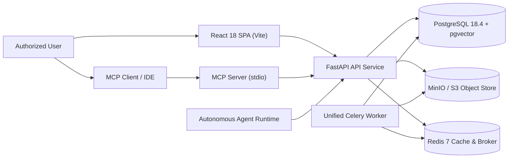
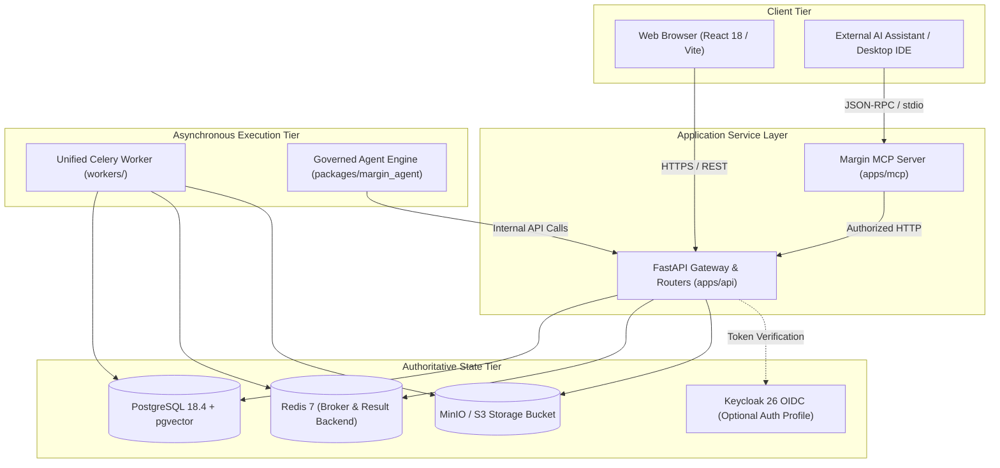
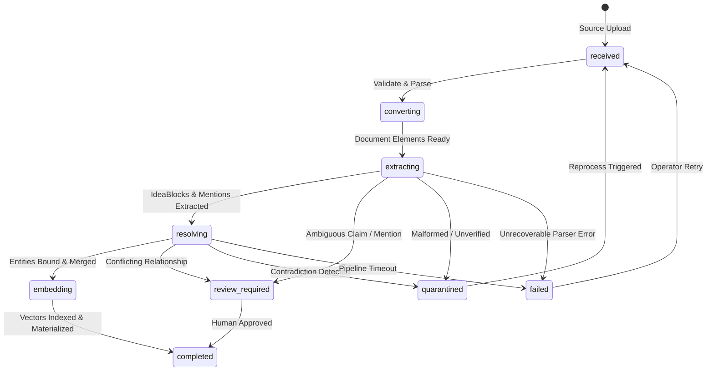
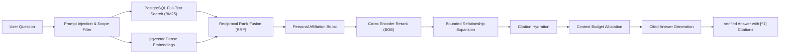
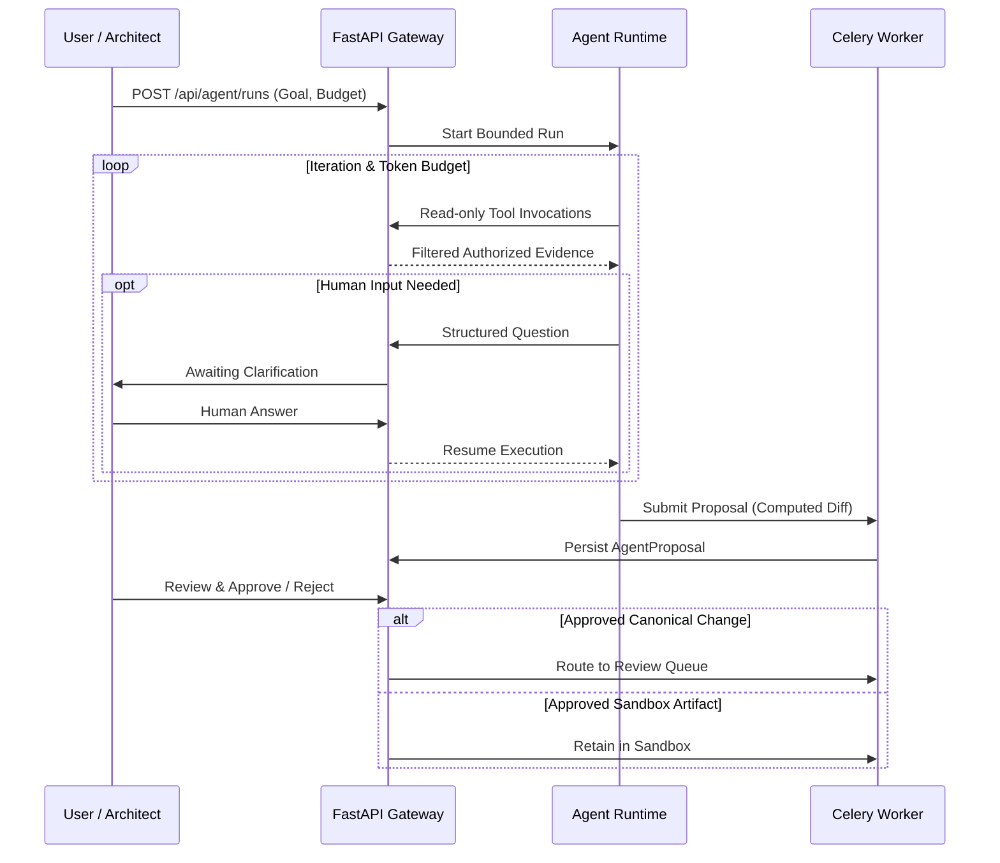
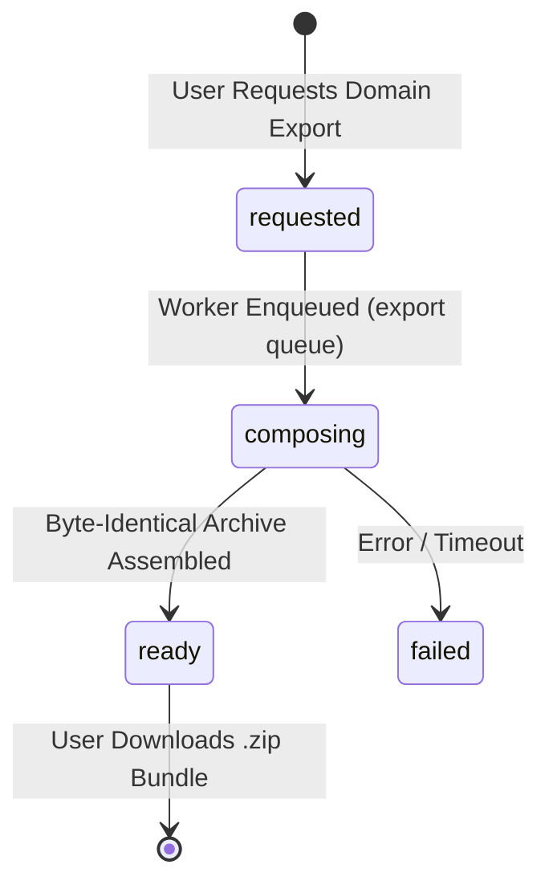

# Margin Architecture

Margin is an enterprise knowledge management system and a corporate second brain with AI-assisted "Ask your knowledge". It turns multi-format architecture documentation, technical specifications, and organizational knowledge into verifiable atomic IdeaBlocks, canonical entity catalogs, explicit evidence-backed relationships, unified governance records, and citable AI answers.

PostgreSQL 18.4 with `pgvector` 0.8.5 serves as the authoritative system of record for canonical entities, IdeaBlocks, graph relationships, and embeddings, while S3-compatible object storage retains immutable source documents and converted artifacts.

## Table of contents

- [Purpose and system boundary](#purpose-and-system-boundary)
- [Runtime and deployment topology](#runtime-and-deployment-topology)
- [Canonical knowledge model](#canonical-knowledge-model)
- [Multi-format ingestion pipeline](#multi-format-ingestion-pipeline)
- [Atomic IdeaBlocks and evidence provenance](#atomic-ideablocks-and-evidence-provenance)
- [Canonical entities and controlled vocabulary](#canonical-entities-and-controlled-vocabulary)
- [Relationships and bounded graph exploration](#relationships-and-bounded-graph-exploration)
- [Unified architecture governance and review queue](#unified-architecture-governance-and-review-queue)
- [Hybrid retrieval and conversational "Ask Margin"](#hybrid-retrieval-and-conversational-ask-margin)
- [On-demand reading surfaces and Architecture Wiki](#on-demand-reading-surfaces-and-architecture-wiki)
- [Personal layer ("Your Space")](#personal-layer-your-space)
- [Autonomous agent runtime and playbooks](#autonomous-agent-runtime-and-playbooks)
- [Model Context Protocol (MCP) server](#model-context-protocol-mcp-server)
- [Deterministic domain export bundles](#deterministic-domain-export-bundles)
- [Authorization and security model](#authorization-and-security-model)
- [Database and vector persistence](#database-and-vector-persistence)
- [Explicit architectural exclusions](#explicit-architectural-exclusions)
- [Architecture decision history](#architecture-decision-history)

## Purpose and system boundary

Margin is a modular monolith designed to maintain verifiable architecture knowledge across enterprise systems. Rather than relying on static wiki pages or untracked documentation repositories, Margin continuously validates, traces, and grounds every architecture claim against source evidence.



### Core boundary rules

- **Authoritative store**: PostgreSQL 18.4 is the operational system of record for source metadata, normalized elements, IdeaBlocks, canonical entities, relationships, governance records, review tasks, vector embeddings, and audit trails.
- **Immutable artifact store**: Object storage holds immutable raw source documents and rendered previews. It is not an alternative database.
- **Single API surface**: The web application, MCP server, and agent runtime all interact through the authenticated FastAPI HTTP surface.
- **Bounded execution**: The Celery background worker processes heavy conversion, extraction, embedding, review, and export tasks across six isolated logical queues.

## Runtime and deployment topology



The system deploys as standard containerized services defined in `infra/docker-compose.yml`:

- `api`: FastAPI application with ASGI workers and health probes.
- `worker`: Unified Celery worker consuming background tasks.
- `web`: Nginx-hosted production bundle of the React 18 frontend.
- `postgres`: PostgreSQL 18.4 with `pgvector` 0.8.5 extension for relational data and vector indexing.
- `redis`: Redis 7 alpine instance for task queues and ephemeral caching.
- `minio`: S3-compatible high-performance object storage.
- `keycloak`: Optional enterprise OpenID Connect identity provider.

## Canonical knowledge model

Margin structures information in a disciplined hierarchy from raw source uploads to verified canonical records:

```mermaid
flowchart LR
    source["Uploaded Source Document"] --> version["Source Version"]
    version --> page["Converted Page"]
    page --> element["Normalized Element"]
    element --> evidence["Claim Evidence"]
    evidence --> block["IdeaBlock Revision"]
    block --> entity["Canonical Entity"]
    block --> relation["Entity Relationship"]
    entity --> alias["Alias & Mention"]
    block --> gov["Governance Record"]
    gov --> review["Review Task"]
    entity --> graph["On-Demand Graph"]
    relation --> graph
```

| Record Type | Description | System of Record |
| --- | --- | --- |
| `SourceDocument` | Uploaded document metadata, format, checksum, and ownership | PostgreSQL |
| `SourceVersion` | Immutable version tracking for reprocessed sources | PostgreSQL |
| `SourceElement` | Citable text block, table, diagram, or code section with bounding box | PostgreSQL |
| `IdeaBlock` | Persistent atomic claim identifier (`ib_...`) | PostgreSQL |
| `IdeaBlockRevision` | Immutable versioned claim statement, lifecycle status, and author | PostgreSQL |
| `ClaimEvidence` | Verified link binding an IdeaBlock revision to an exact source element | PostgreSQL |
| `Entity` | Governed architectural component, system, team, or domain | PostgreSQL |
| `EntityAlias` | Alternate name, acronym, or deprecated naming convention | PostgreSQL |
| `EntityRelationship` | Typed, evidence-backed edge connecting two canonical entities | PostgreSQL |
| `GovernanceRecord` | ADR, Risk, Waiver, Technical Debt, or Backlog item | PostgreSQL |
| `ReviewTask` | Human review bundle for ambiguous, conflicting, or quarantined items | PostgreSQL |

## Multi-format ingestion pipeline



### Supported document converters

1. **Rich documents**: Primary processing via `DoclingPrimaryConverter` (PDF, DOCX, PPTX) extracting semantic layout, reading order, and tables. `MarkItDownSecondaryConverter` provides secondary fallback.
2. **Visual assets & raster images**: `ImageConverter` (PNG, JPEG, TIFF, WebP) handles visual diagram conversion and optical extraction.
3. **Structured text & specs**: Lightweight dependency-free converters handle Markdown, YAML, JSON, and raw text files.
4. **Diagram sources**: Native parsers convert Mermaid (`.mmd`, `.mermaid`), PlantUML (`.puml`, `.plantuml`, `.iuml`), and Structurizr DSL (`.dsl`).
5. **API contracts**: OpenAPI (v2, v3, v3.1) and AsyncAPI (v2, v3) specifications are extracted into canonical API, operation, schema, channel, and security scheme entities.

## Atomic IdeaBlocks and evidence provenance

IdeaBlocks are the primary unit of architecture knowledge in Margin:

- **Deterministic identification**: Every block receives a deterministic SHA-256 hash prefix (`ib_...`).
- **One claim per block**: An IdeaBlock encapsulates exactly one falsifiable statement.
- **Immutable revision chain**: Revisions cannot be updated in place. Edits append a new `IdeaBlockRevision` with recorded justification.
- **Governed states**: Every revision has a lifecycle state (`candidate`, `verified`, `duplicate`, `stale`, `rejected`, `superseded`).
- **Bidirectional provenance**: Users can drill down from any IdeaBlock to its exact source document, page, and quoted passage.

## Canonical entities and controlled vocabulary

Margin maintains a controlled entity registry preventing vocabulary duplication across disparate teams:

- **Entity taxonomy**: Covers Domains, Systems, Containers, Components, APIs, Databases, Services, Teams, and Roles.
- **Alias resolution**: Tracks historical aliases, legacy acronyms, and common abbreviations.
- **Mention queue**: Text mentions with low confidence are queued for human binding (`POST /api/entities/mentions/{id}/resolve`).
- **Entity lifecycle operations**: Explicit actions for approving drafts, merging duplicates, deprecating aliases, superseding with successors, and retiring obsolete entities.
- **Cascading re-resolution**: Background workers automatically update historical claims when entities merge or change aliases.

## Relationships and bounded graph exploration

Relationships represent explicit, evidence-backed connections between architectural entities:

- **Strict provenance**: Every relationship record carries confidence metrics, review states, validity dates (`valid_from`, `valid_to`), and source element provenance.
- **Bounded SQL traversal**: Neighbor queries, path analysis, blast radius / impact analysis, and governance links execute as high-performance SQL queries directly in PostgreSQL 18.4.
- **Dynamic graph analytics**: Louvain community detection, surprising connections, knowledge gaps, and graph hygiene checks are computed on demand in memory and discarded. No out-of-sync graph database projections are used.
- **Reader attention controls**: Readers can permanently dismiss or temporarily defer surfaced graph findings without altering canonical facts.

## Unified architecture governance and review queue

Margin unifies architecture governance into five first-class record types:

1. **Architecture Decision Records (ADRs)**: Versioned decision log capturing context, options, decision, and consequences.
2. **Architecture Risks**: Identified operational, architectural, or security risks with severity and mitigations.
3. **Architectural Waivers**: Formal time-bounded dispensations with mandatory renewal and revocation lifecycles.
4. **Technical Debt**: Explicitly tracked architectural debt items with estimated remediation effort.
5. **Architecture Backlog**: Actionable architecture initiatives linked directly to origin governance records.

### Review queue workflows

The review queue manages ambiguous, conflicting, or quarantined items:

- Assembles comprehensive evidence bundles containing quoted passages, candidate claims, and conflicting entities.
- Records semantic reviewer decisions with audit logs.
- Automated contradiction and blind-spot detection proactively submits findings to the queue.

## Hybrid retrieval and conversational "Ask Margin"



- **Two-stage hybrid retrieval**: Fuses lexical BM25 candidates with dense vector candidates from `pgvector` using Reciprocal Rank Fusion.
- **Precision reranking**: Evaluates top fused candidates using `BAAI/bge-reranker-base`.
- **Governed Ask Margin**: Synthesizes answers strictly derived from authorized citations. If sufficient verified evidence cannot be assembled, the response safely falls back to search results.
- **Conversational threads**: Supports multi-turn question answering (`/ask/:threadId`) with retained conversational context and continuous authorization enforcement.
- **Context budgeting**: Enforces strict character and token limits across index context, evidence records, and answer reserved allocations.

## On-demand reading surfaces and Architecture Wiki

Margin rejects static compiled wiki files in favor of dynamic reading surfaces synthesized directly from canonical records:

- **Dynamic Architecture Wiki**: Generates on-demand markdown views covering domains, systems, components, governance records, and C4 hierarchies.
- **Domain narratives**: Automatically generated architectural narratives distinguishing verified facts from candidate claims.
- **Domain charters**: Versioned scoping documents authored by domain stewards that steer ingestion without altering retrieval ranking.
- **Architecture Health heatmap**: Real-time visual metrics across domains tracking stale claims, unowned entities, high risks, expired waivers, and missing ADRs.
- **C4 Explorer**: Interactive hierarchy navigation (Domain -> System -> Container -> Component) linked to live governance.

## Personal layer ("Your Space")

Your Space (`/me`) provides a personalized experience without polluting canonical knowledge:

- **Private workspace**: Stores private notes, bookmarked claims, custom saved views, and conversation threads.
- **Non-polluting references**: Notes and bookmarks reference canonical database IDs; personal text cannot become published knowledge without undergoing formal ingestion.
- **Personal feed**: Curates recommended reading based on user domain affinity, team ownership, and newly verified claims.
- **Deterministic personal exports**: Domain export packages are generated from Your Space.

## Autonomous agent runtime and playbooks



- **Strict execution budgets**: Runs are strictly limited by maximum iterations and token allocations, with support for mid-flight cancellation.
- **Read-only tool default**: Tools (`knowledge_search`, `knowledge_entity`, `knowledge_neighbors`, `knowledge_evidence`, `domain_narrative`) operate in read-only mode unless explicit write authority is granted.
- **Non-destructive diff proposals**: The agent produces structured diff proposals (`AgentProposal`) requiring human approval. Approved canonical changes become review tasks rather than bypassing governance.
- **Domain playbooks**: Playbooks are discovered dynamically across operator paths, the repository `playbooks/` folder, and `~/.margin/playbooks/`.

## Model Context Protocol (MCP) server

Margin includes a native Model Context Protocol (MCP) server (`apps/mcp`) running over standard I/O (JSON-RPC):

- **Architecture**: Runs as a separate process communicating with the Margin API over authenticated HTTP.
- **Inherited authorization**: Leverages existing user tokens or configured service principals, ensuring third-party AI assistants inherit exact RBAC permissions and audit logging.
- **MCP tools**: `margin_search`, `margin_ask`, `margin_get_entity`, `margin_get_neighborhood`, `margin_get_evidence`, `margin_get_graph`, `margin_raise_review`.
- **MCP resources**: `margin://domains`, `margin://domain/{id}`, `margin://domain/{id}/briefing`, `margin://entity/{id}`, `margin://evidence/{id}`.

## Deterministic domain export bundles



- **Security scoping**: Exports are filtered by the requester's RBAC permissions at creation time.
- **Cryptographic determinism**: Given identical canonical records, exports generate byte-identical `.zip` archives with matching SHA-256 hashes.
- **Excluded by construction**: Exports structurally exclude secrets, embedding vectors, extraction caches, personal notes, and internal audit logs.

## Authorization and security model

Margin implements an enterprise-grade multi-dimensional RBAC engine:

- **Roles**: `Viewer`, `Architect`, `Domain Steward`, `Governance Admin`, `Platform Admin`, `Auditor`.
- **Resource dimensions**: Domain scoping, Category scoping, and Sensitivity thresholds (`internal`, `confidential`, `restricted`).
- **Actions**: `read`, `write`, `review`.
- **Authoritative validation**: Security checks occur on every API call. UI visibility is purely advisory.
- **Permanent audit log**: All state transitions, approvals, rejections, merges, and export requests generate tamper-evident audit records.

## Database and vector persistence

PostgreSQL 18.4 with `pgvector` 0.8.5 is the authoritative system of record:

- **Single operational store**: Relational data, foreign keys, full-text indexes (`tsvector`), and vector embeddings (`vector(384)`) reside in the same database.
- **Alembic migration sequence**: Exactly 23 linear migrations from `0001_initial_schema` to `0023_ingestion_job_sequence`.
- **Vector search integration**: Hybrid queries leverage PostgreSQL's native vector distance operators (`<=>` for cosine similarity) alongside relational filters.

## Explicit architectural exclusions

The following components and patterns are intentionally excluded:

- **No compiled static wikis or Git mirrors**: Content is dynamically composed from canonical database records.
- **No external vector or graph databases**: No Neo4j, Qdrant, Milvus, Weaviate, or OpenSearch clusters.
- **No ungrounded AI answers**: Answers without verifiable evidence citations are prohibited.
- **No autonomous unreviewed writes**: Agents cannot alter the canonical knowledge base without human review.

## Architecture decision history

All architectural decisions are formally documented in [docs/architecture/ADRS.md](architecture/ADRS.md):

- **ADR-0001**: PostgreSQL as Authoritative System of Record (Accepted).
- **ADR-0002**: Governed Inference Policy & Model Decoupling (Accepted).
- **ADR-0003**: Retrieval Strategy & Hybrid Search (Superseded by ADR-0006).
- **ADR-0004**: Git Mirror Strategy (Superseded by ADR-0006).
- **ADR-0005**: Source Reuse and Deduplication Strategy (Accepted).
- **ADR-0006**: Final Simplified Modular Monolith Architecture (Accepted).
