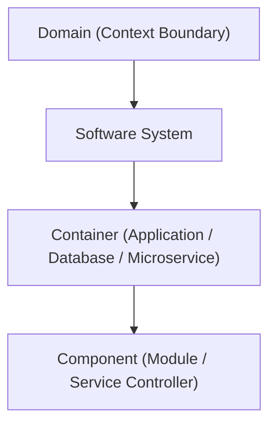

# Margin Metamodel

This document defines the formal information architecture, taxonomy, entity hierarchies, relationship rules, and provenance model of Margin.

Margin organizes enterprise architecture into a unified, mathematically consistent model where every claim is an atomic verifiable statement tied to source evidence and governed by an active ontology version.

## Table of contents

- [Information architecture overview](#information-architecture-overview)
- [Source categories](#source-categories)
- [Entity and relationship vocabulary](#entity-and-relationship-vocabulary)
- [Knowledge lifecycle states](#knowledge-lifecycle-states)
- [Provenance mapping (W3C PROV)](#provenance-mapping-w3c-prov)
- [C4 model hierarchical mapping](#c4-model-hierarchical-mapping)
- [Organizational and ownership mapping](#organizational-and-ownership-mapping)
- [Reader decision mapping](#reader-decision-mapping)
- [Domain charters and boundaries](#domain-charters-and-boundaries)
- [Personal workspace mapping](#personal-workspace-mapping)
- [Dublin Core metadata mapping](#dublin-core-metadata-mapping)

## Information architecture overview

The Margin metamodel establishes strict boundaries between source evidence, extracted claims, canonical entities, and governance records. Rather than allowing loose, ungrounded wiki text, every concept maps to an explicit database entity in PostgreSQL 18.4.

## Source categories

Sources are systematically classified into governed architectural categories:

- `research`: Exploratory architecture research, whitepapers, and industry benchmarks.
- `design`: System architecture documents, High-Level Designs (HLDs), and Low-Level Designs (LLDs).
- `adr`: Formal Architecture Decision Records documenting accepted technical choices.
- `waiver`: Approved exceptions and temporary waivers granted against corporate standards.
- `risk`: Formal architecture, security, or compliance risk records.
- `tech_debt`: Explicitly tracked technical debt items with remediation scope.
- `backlog`: Actionable architecture backlog tasks and initiatives.
- `standard`: Enterprise architecture policies, technology guidelines, and security baselines.

## Entity and relationship vocabulary

- **Entity registry**: The canonical entity-kind registry (`margin_schema.ontology.ENTITY_KIND_REGISTRY`) governs permitted entity types, required attributes, and lifecycle state machines.
- **Relationship registry**: The canonical relationship registry (`margin_schema.ontology.RELATIONSHIP_REGISTRY`) dictates permitted directed and symmetric relationship edges between entities.
- **Validation**: Both registries constrain ingestion parsers, extraction models, relationship persistence, and bounded SQL traversals.

## Knowledge lifecycle states

Every IdeaBlock revision in Margin exists in exactly one governed state:

- `verified`: Grounded in approved source evidence and confirmed by deterministic parsing or human governance review.
- `candidate` / `extracted`: Directly extracted from source evidence, pending formal governance review.
- `inferred` / `ambiguous`: Extracted with lower confidence or multiple candidate matches; queued for human review.
- `contradicted`: Conflicting with another verified architectural claim; flagged for review.
- `stale`: Historical claim whose validity dates have lapsed or whose successor entity has been introduced.
- `rejected`: Explicitly rejected by a governance reviewer.
- `superseded`: Replaced by a newer revision or successor architectural claim.

## Provenance mapping (W3C PROV)

Margin implements a rigorous provenance model adhering to W3C PROV standards:

- **Entity**: The artifact or proposition being tracked: `SourceDocument`, `SourcePage`, `SourceElement`, `IdeaBlockRevision`, `Entity`, `EntityRelationship`, `GovernanceRecord`.
- **Activity**: The transformation or process that created or modified the entity: `conversion`, `extraction`, `entity_resolution`, `review`, `embedding`, `governance_transition`.
- **Agent**: The actor responsible for the activity: `AuthorizedUser`, `UnifiedWorker`, `DoclingConverter`, `MarkItDownConverter`, or configured `ModelEndpoint`.

AI models can create candidate claims but can never create verified facts without passing through evidence-grounded review paths.

## C4 model hierarchical mapping

Margin maps architecture assets directly to the C4 hierarchical model:

- **Domain**: High-level organizational or business capability context.
- **Software System**: Primary deployable software solution.
- **Container**: Independently executable applications, microservices, datastores, or serverless functions.
- **Component**: Modular controllers, service layers, and internal components within a container.
- **APIs & Datastores**: First-class entity kinds mapped as interfaces and persistent targets for containers.

The C4 explorer composes views on demand from relational foreign keys in PostgreSQL 18.4 without maintaining separate graph projections.

## Organizational and ownership mapping

Architecture governance requires clear human ownership:

- **Organizational entities**: `Team`, `Person`, `Role`, `Organization`, `Capability`, `ValueStream`, and `Process` are canonical entity kinds.
- **Ownership edges**: `member_of`, `reports_to`, `works_on`, `owns`, and `owned_by` / `has_custodian` connect organizational entities to technology assets.
- **Bidirectional reads**: Ownership is queryable in both directions: `owned_by` navigates from an asset to its responsible custodian, while `owns` enumerates all assets managed by a team or platform.

## Reader decision mapping

Reader attention decisions allow individual architects to manage information density:

- **Dismissal (`dismiss`)**: Permanently hides a surfaced graph connection or knowledge gap for the specific user.
- **Deferral (`defer`)**: Temporarily suppresses a finding until a designated expiration timestamp.
- **Corpus integrity**: Reader decisions reflect individual attention preferences and never mutate or delete underlying canonical facts.

## Domain charters and boundaries

A domain charter is versioned prose authored and maintained by a domain steward:

- Establishes domain purpose, technical boundaries, out-of-scope items, and controlled terminology.
- Injected into automated extraction pipelines to guide domain categorization.
- Charters guide extraction boundaries but never influence search relevance or ranking.

## Personal workspace mapping

Your Space (`/me`) isolates personal artifacts from published architecture records:

- Personal notes, saved records, bookmarked claims, and custom views reference canonical database IDs.
- Personal items are strictly private to the user principal.
- Personal records cannot become verified claims without formal document upload and governance review.

## Dublin Core metadata mapping

Every ingested source document captures Dublin Core metadata fields:

- `title`: Document title or extracted file heading.
- `creator`: Authoring principal, organization, or tool.
- `subject`: Domain, architecture category, or keywords.
- `date`: Ingestion timestamp and original document publication date.
- `format`: MIME type, file extension, and parser engine used.
- `identifier`: Cryptographic SHA-256 hash and unique source ID.
