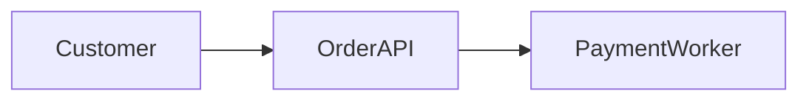

# Customer Platform HLD

<!-- page: 1 -->

The customer platform supports order capture and payment processing.

## Context

The platform separates synchronous order intake from asynchronous payment processing.

- Order API accepts customer orders.
- Payment Worker processes authorized payments.

Figure: Customer request flow.



```yaml
event_backbone: kafka
```

## Decisions

The services have explicit responsibilities and accountable owners.

| System         | Responsibility              | Owner         |
| -------------- | --------------------------- | ------------- |
| Order API      | Accept customer orders      | Commerce Team |
| Payment Worker | Process authorized payments | Payments Team |

The Order API invokes the payment workflow after accepting an order.

| Source    | Relation   | Target         |
| --------- | ---------- | -------------- |
| Order API | depends_on | Payment Worker |
